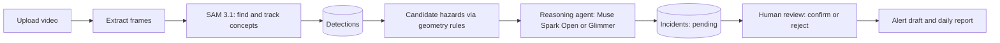

# Surokkha

**An agentic safety monitor for garment factories, built on Meta's open-weight models.**

*Surokkha* (সুরক্ষা) means "safety" in Bangla.

> **Hackathon statement.** Surokkha is being built during the **Meta Global AI Developer Hackathon** (build window Oct 27 to Nov 4, 2026), **Indie Developer track**, by a solo developer. All code in this repository was written during the event. Open-source libraries and Meta's published models are used as dependencies and are listed below.

**Status:** in development. The table in [Project status](#project-status) shows what works today. Nothing in this README claims a feature that is not marked as done.

---

## Table of contents

1. [What it does](#what-it-does)
2. [Why it matters](#why-it-matters)
3. [How it works](#how-it-works)
4. [Meta models used](#meta-models-used)
5. [Features](#features)
6. [Project status](#project-status)
7. [Tech stack](#tech-stack)
8. [Project structure](#project-structure)
9. [Getting started](#getting-started)
10. [Evaluation](#evaluation)
11. [Safety, privacy and ethics](#safety-privacy-and-ethics)
12. [Limitations](#limitations)
13. [Roadmap](#roadmap)
14. [Documentation](#documentation)
15. [License and acknowledgements](#license-and-acknowledgements)

---

## What it does

Surokkha takes factory video and does four things:

1. **Finds hazards** in the footage.
2. **Builds an incident timeline** with visual evidence (frames and overlays).
3. **Drafts a supervisor alert** for each incident.
4. **Produces a daily safety report.**

A human always has the last word: every incident is **confirmed or rejected by a person** before it counts. The software never sends anything on its own.

**Hazards in the MVP:**

| Hazard | Meaning |
|---|---|
| Missing PPE | A worker without the required protective gear (default: face mask; head cover or helmet is configurable) |
| Blocked exit or aisle | Boxes, carts or other obstructions in or near an exit or marked aisle |

## Why it matters

Bangladesh's garment industry is the country's largest export sector and has a history of serious factory safety failures, including the 2013 Rana Plaza collapse. Safety checks still rely heavily on people walking the floor, and cameras are only useful if someone has time to watch them.

Surokkha is a prototype of one idea: an agent that watches for a small set of high-value hazards and hands a safety officer a short list with evidence. This is a hypothesis, not a proven result. Sources are collected in [`docs/sources.md`](docs/sources.md).

## How it works



1. **Detect objects, then reason.** SAM 3.1 finds concepts from short text prompts (`person`, `face mask`, `helmet`, `door`, `box`, `cart`). A "missing mask" candidate is created when a `person` has no overlapping `face mask`.
2. **Reason with evidence.** A Meta open-weight model receives the candidates, nearby detections and a key frame, and returns **validated JSON**: keep or discard, severity, a short explanation and an alert draft.
3. **Human gate.** Incidents start as `pending`. A person confirms or rejects them, and the decision is recorded with a timestamp.

Full details: [`docs/Architecture.md`](docs/Architecture.md).

## Meta models used

| Model | Role in Surokkha |
|---|---|
| **SAM 3.1** (Segment Anything with Concepts) | Text-prompted detection, segmentation and tracking of objects in video frames |
| **Muse Spark Open** (served through partner inference) | Reasoning agent: validates hazard candidates, writes explanations and alert drafts |
| **Muse Glimmer** | Planned fallback for the reasoning agent |

SAM 3.1 checkpoints are gated on Hugging Face and the code lives in the official [`facebookresearch/sam3`](https://github.com/facebookresearch/sam3) repository. You must request access and accept the license yourself.

## Features

- [ ] **F1** Video ingest with required footage source and license
- [ ] **F2** Concept detection and tracking with SAM 3.1
- [ ] **F3** Hazard reasoning agent with validated structured output
- [ ] **F4** Incident timeline with evidence and overlays
- [ ] **F5** Human confirmation gate and alert drafts
- [ ] **F6** Daily safety report
- [ ] **F7** Reproducible evaluation (precision and recall on labeled clips)

Stretch goals (only after F1 to F7 work end to end): WhatsApp alert delivery with a test number, Bangla alert text.

## Project status

| Area | Status |
|---|---|
| Repository, scope and project docs | Done |
| SAM 3.1 access | Requested, waiting for approval |
| Perception pipeline | Not started |
| Reasoning agent | Not started |
| Dashboard | Not started |
| Evaluation | Not started |

*This table is updated as work lands.*

## Tech stack

| Layer | Technology |
|---|---|
| Backend | Python, FastAPI, Pydantic, SQLAlchemy (SQLite) |
| Video | OpenCV, ffmpeg |
| Perception | SAM 3.1 on a rented GPU |
| Reasoning | Muse Spark Open through partner inference |
| Frontend | React, Vite, Tailwind CSS |
| Testing | pytest |

## Project structure

```
surokkha/
├── docs/               # PRD, architecture, rules, design, tasks, memory
├── backend/            # FastAPI app, services, models, tests
├── perception_worker/  # SAM 3.1 inference on a GPU
├── eval/               # labels and evaluation script
├── frontend/           # React dashboard
├── samples/            # sample clips (small) and their licenses
├── .env.example        # variable names only
└── README.md
```

The folder layout above is the plan. Folders appear as the code lands.

## Getting started

> These steps describe the planned setup and will be confirmed as each part is built. If a step does not work yet, check [Project status](#project-status).

### Prerequisites

- Python 3.12
- Node.js (current LTS)
- ffmpeg installed and on your path
- A GPU environment for SAM 3.1 (see the SAM 3 repository for requirements)
- Access to the SAM 3.1 checkpoints on Hugging Face (request and accept the license)
- Credentials for the partner endpoint that serves Muse Spark Open

### 1. Clone and configure

```bash
git clone https://github.com/Nazmuz-Saif/Surokkha.git
cd Surokkha
cp .env.example .env     # on Windows PowerShell: Copy-Item .env.example .env
```

Open `.env` and fill in your own values. **Never commit `.env`.**

### 2. Backend

```bash
cd backend
python -m venv .venv
# Windows: .venv\Scripts\activate    macOS/Linux: source .venv/bin/activate
pip install -r requirements.txt
uvicorn app.main:app --reload
```

### 3. Perception worker

Follow the instructions in `perception_worker/README.md` (added with the worker).

### 4. Frontend

```bash
cd frontend
npm install
npm run dev
```

### 5. Run the tests

```bash
cd backend
pytest
```

## Evaluation

The evaluation runs the pipeline on a set of labeled clips and reports precision and recall per hazard, including the failures.

```bash
python eval/run_eval.py
```

Results will be published in `eval/results/` and shown in the dashboard. **No accuracy numbers are claimed until they are measured.**

## Safety, privacy and ethics

- **Human in the loop.** Nothing is confirmed without a person's decision.
- **No identification of people.** Surokkha detects objects and conditions (such as a missing mask). It does not recognize, name or track individuals.
- **Untrusted inputs.** Model output is validated against schemas and never executed. Text that appears in video is treated as data, not instructions.
- **Secrets.** Keys live only in `.env`, which is git-ignored.
- **Footage.** Only footage that is the author's own, staged with consent, or properly licensed is used. The source and license of each clip are recorded.
- **Not a certification tool.** Surokkha is a prototype. It does not replace safety inspectors, audits or legal compliance processes.

## Limitations

- It is a hackathon prototype built in about a week by one developer.
- Detection quality depends on camera angle, lighting, resolution and occlusion.
- It covers two hazard types only.
- Results on staged or licensed sample footage may not match real factory conditions.
- Perception needs GPU resources.

## Roadmap

After the hackathon (not part of the MVP): more hazard types, multi-camera views, a Bangla interface, live streaming.

## Documentation

| File | Contents |
|---|---|
| [`docs/Prd.md`](docs/Prd.md) | Product requirements |
| [`docs/Architecture.md`](docs/Architecture.md) | System design, stack, data model |
| [`docs/Rules.md`](docs/Rules.md) | Project rules and library policy |
| [`docs/Design.md`](docs/Design.md) | UI design |
| [`docs/Task.md`](docs/Task.md) | Day-by-day plan |
| [`docs/Memory.md`](docs/Memory.md) | Decisions, changes and bug log |
| [`docs/scope.md`](docs/scope.md) | MVP scope |

## License and acknowledgements

- Code in this repository is released under the license in [`LICENSE`](LICENSE).
- **SAM 3.1** and **Muse** models are Meta's work and are used under their own licenses and terms. Check each model's license before reuse.
- Thanks to Meta and Cerebral Valley for organizing the hackathon, and to the inference partners for compute credits.

**Author:** [Nazmuz Saif](https://github.com/Nazmuz-Saif)
