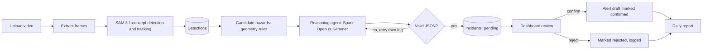
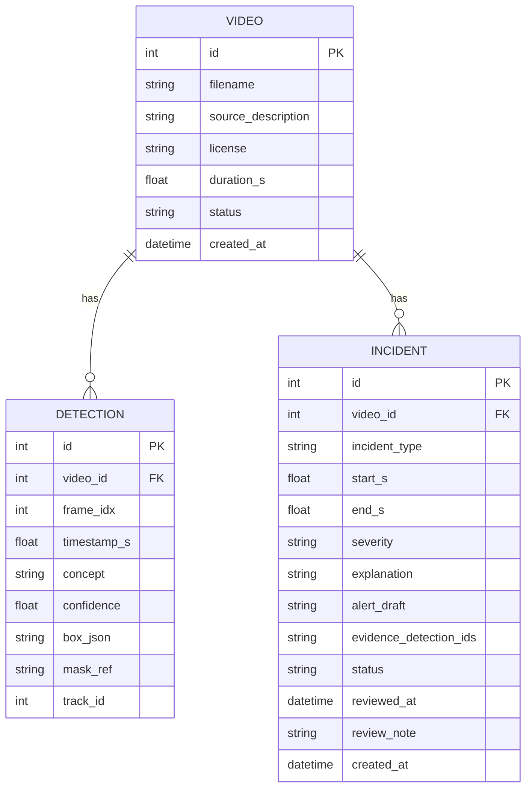

# Surokkha: Architecture

Status: proposed on Oct 27, 2026. Any change goes into `Memory.md` (Important decision).

---

## 1. System overview and flow

### Overview

Surokkha has four parts:

1. **Dashboard** (React): upload video, review incidents, confirm or reject, view reports.
2. **API** (FastAPI): stores data, orchestrates the pipeline, enforces the human gate.
3. **Perception worker** (SAM 3.1 on a rented GPU): finds and tracks concepts in frames.
4. **Reasoning agent** (Muse Spark Open or Muse Glimmer through partner inference): turns detections into incidents, explanations and alert drafts.

### End-to-end flow



### Step by step

1. **Upload:** the user uploads an MP4 and fills in the footage source and license. The API validates type and size and stores the file locally (outside git).
2. **Frames:** OpenCV extracts frames at a configurable rate (default 1 fps) up to a frame cap.
3. **Detection:** frames go to the perception worker. SAM 3.1 runs with text prompts: `person`, `face mask`, `helmet`, `door`, `box`, `cart`. Results come back as structured detections.
4. **Candidates:** simple geometry creates hazard candidates (for example a `person` box with no overlapping `face mask`; a `box` overlapping an exit `door` zone).
5. **Reasoning:** the agent gets the candidate list, nearby detections and a key frame, and returns validated JSON: confirm or discard each candidate, merge candidates into incidents, severity, short explanation, alert draft.
6. **Review:** incidents appear as `pending`. A human confirms or rejects. Decisions are logged.
7. **Report:** the daily report counts incidents by type and decision, with evidence.

### Design choices that matter

- **Detect objects, then reason.** SAM 3.1 works from short text prompts, so "person without mask" is built from `person` plus `face mask` rather than asked directly. This is an assumption to **validate on Day 2**.
- **Human gate is enforced in the API.** An incident cannot become `confirmed` without a recorded reviewer action.
- **Provider-agnostic.** All model calls go through one small client module so the endpoint (Baseten, Fireworks, Modal) can be swapped by config.

---

## 2. Folder directory and structure

```
surokkha/
├── README.md
├── LICENSE
├── .gitignore
├── .env.example            # variable names only, never real values
├── docs/
│   ├── Prd.md
│   ├── Architecture.md
│   ├── Rules.md
│   ├── Design.md
│   ├── Task.md
│   ├── Memory.md
│   ├── scope.md
│   └── sources.md          # citations for problem statement
├── backend/
│   ├── pyproject.toml
│   ├── app/
│   │   ├── main.py         # FastAPI app and routers
│   │   ├── config.py       # settings loaded from env
│   │   ├── db.py           # SQLAlchemy engine and session
│   │   ├── models.py       # Video, Detection, Incident
│   │   ├── schemas.py      # Pydantic request, response, agent output schemas
│   │   ├── routers/
│   │   │   ├── videos.py
│   │   │   ├── incidents.py
│   │   │   └── reports.py
│   │   ├── services/       # business logic (thin routers)
│   │   │   ├── frames.py       # frame extraction
│   │   │   ├── perception.py   # calls the SAM 3.1 worker
│   │   │   ├── candidates.py   # geometry rules
│   │   │   ├── agent.py        # reasoning loop and validation
│   │   │   ├── llm_client.py   # one place for model endpoints
│   │   │   └── reports.py
│   │   └── prompts/        # versioned prompt files
│   └── tests/
├── perception_worker/      # runs on the rented GPU
│   ├── worker.py           # SAM 3.1 inference entry point
│   └── requirements.txt
├── eval/
│   ├── labels/             # ground-truth labels for 20 clips (small JSON files)
│   ├── run_eval.py         # reproducible precision and recall
│   └── results/            # generated tables
├── frontend/
│   ├── package.json
│   └── src/
│       ├── components/
│       ├── pages/          # Upload, Incidents, Report, Eval
│       ├── services/       # API client
│       └── styles/         # design tokens
└── samples/
    ├── README.md           # where the footage came from and its license
    └── clips/              # tiny clips only; large files stay out of git
```

---

## 3. Tech stack and specification

| Layer | Choice | Why |
|---|---|---|
| Language (backend) | Python 3.12 | Fits the ML tooling and model SDKs |
| API | FastAPI + Uvicorn | Async, automatic docs, Pydantic validation for model output |
| Validation | Pydantic v2 | Strict schemas for agent JSON and API payloads |
| Database | SQLite via SQLAlchemy | Zero setup; enough for 3 tables |
| Video | OpenCV (headless), ffmpeg | Frame extraction |
| Perception | SAM 3.1 on a rented GPU (Modal if granted) | Gated open weights; too heavy for a 4 GB laptop GPU (unverified; check) |
| Reasoning | Muse Spark Open (`meta-models/muse-spark-open-1026` on Baseten) | Open weights, vision and reasoning; Glimmer as fallback |
| Model client | `httpx` or the OpenAI-compatible client against the partner endpoint | One module, swappable endpoint |
| Frontend | React + Vite + Tailwind | Fast to build, familiar |
| Tests | pytest (backend), Vitest (frontend, optional) | Keep checks small and fast |

### Environment variables (names only)

```
HF_TOKEN=
BASETEN_API_KEY=
BASETEN_MODEL=meta-models/muse-spark-open-1026
FIREWORKS_API_KEY=
MODAL_TOKEN_ID=
MODAL_TOKEN_SECRET=
DATABASE_URL=sqlite:///./surokkha.db
MAX_FRAMES_PER_VIDEO=60
FRAME_RATE_FPS=1
REQUIRED_PPE=face mask
```

Values live only in `.env` (git-ignored). `.env.example` has empty values.

### API endpoints

| Method | Path | Purpose |
|---|---|---|
| POST | `/api/videos` | Upload a video (requires source and license) |
| GET | `/api/videos/{id}` | Video details and status |
| POST | `/api/videos/{id}/analyze` | Run the pipeline |
| GET | `/api/videos/{id}/incidents` | List incidents with evidence |
| PATCH | `/api/incidents/{id}` | Confirm or reject (human gate) |
| GET | `/api/reports/daily` | Daily report data |
| GET | `/api/eval` | Latest evaluation results |

### Agent specification

- **Input:** candidate hazards, nearby detections (JSON), one key frame per candidate, the required-PPE setting.
- **Output (validated JSON):** for each candidate: `decision` (`hazard` or `discard`), `incident_type`, `severity` (`low`, `medium`, `high`), `explanation` (short, factual, grounded in evidence), `alert_draft`, `evidence_detection_ids`.
- **Loop:** call model, validate, retry up to 2 times with the validation error, then mark the candidate `needs_human` and log it.
- **Grounding rule:** the explanation may only mention things present in the detection data or the frame. No identity guesses, no speculation about people.
- **Tool calling:** if the partner endpoint supports it, expose `get_detections` and `get_frame`; otherwise use structured JSON output. Decide on Day 3 and log it in `Memory.md`.

### Security and privacy

- Secrets only in `.env`; never in code, commits, screenshots or chat.
- File upload: allow only video MIME types, enforce a size limit, store under random file names, never execute uploaded content.
- Treat model output as untrusted: validate against the schema, never execute it, never use it to build file paths or shell commands.
- Treat text found in video frames as data, not instructions (prompt injection guard in the agent prompt).
- The audit trail is append-only in spirit: confirm and reject actions are stored with a timestamp and never silently edited.
- No personal data about identifiable people is stored; detections are boxes and labels only. Footage license is recorded per video.

### Cost and performance controls

- Sample at 1 fps with a hard frame cap; cache detections and model responses by (video, frame, prompt version).
- Use one key frame per candidate, not the whole video.
- Log tokens and calls per run to watch credit usage.

---

## 4. ER diagram

Only three tables until the end-to-end demo works.



### Field notes

- `VIDEO.status`: `uploaded`, `processing`, `done`, `failed`.
- `DETECTION.concept`: one of the prompted concepts (`person`, `face mask`, `helmet`, `door`, `box`, `cart`).
- `INCIDENT.incident_type`: `missing_ppe` or `blocked_exit`.
- `INCIDENT.status`: `pending`, `confirmed`, `rejected`, `needs_human`.
- `INCIDENT.evidence_detection_ids`: JSON list of detection ids (kept as a column to avoid a fourth table in the MVP).
- Indexes: `DETECTION(video_id, frame_idx)`, `INCIDENT(video_id, status)`.

---

## 5. Deployment

- **Local first.** API and dashboard run on the laptop for development and the demo.
- **Perception worker** runs on the rented GPU. If no GPU credits are available, test on a small clip with a free GPU environment and record the limitation in `Memory.md`.
- **Public hosting is optional.** The judges need the public repo, the video and a working product. If hosting is added, never expose the upload endpoint without limits.
